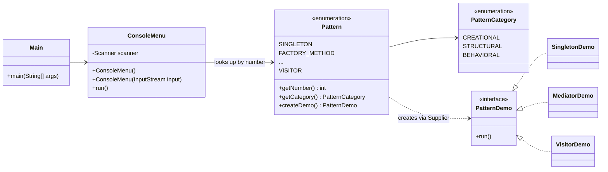
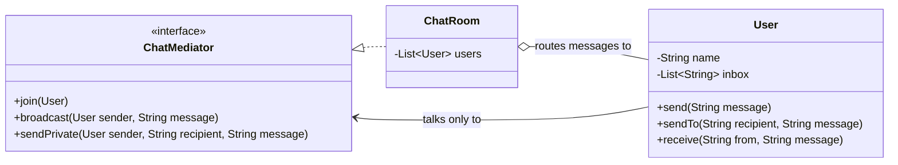
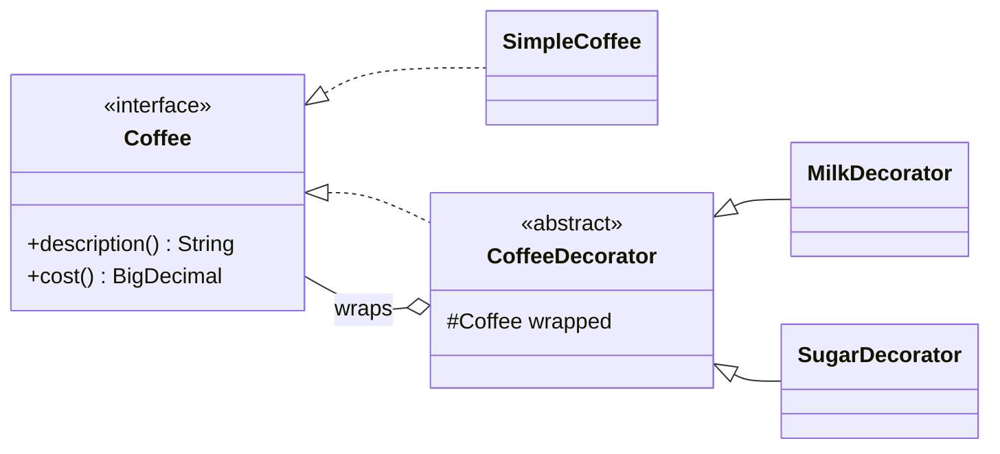
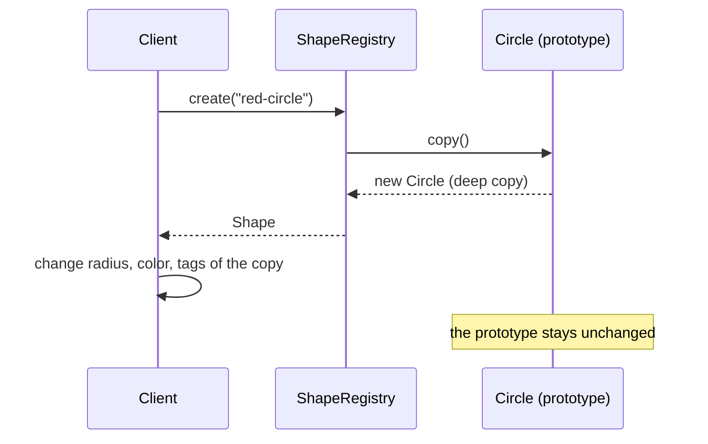

# Design Patterns Showcase


An interactive console application that demonstrates **all 23 classic Gang of Four design patterns** in Java.
Pick a pattern from the menu, and a small, self-contained example runs and explains what is happening.

Each pattern is implemented in a single file of 30–100 lines, with a real-world analogy instead of abstract `Foo`/`Bar` classes:
a pizza builder, a coffee decorator, a home-theater facade, a chat-room mediator and so on.

> The console output of the demos is in Russian; the code, the tests and this document are in English.

---

## Contents

- [Quick start](#quick-start)
- [Sample session](#sample-session)
- [Architecture](#architecture)
- [Pattern catalogue](#pattern-catalogue)
- [A closer look at a few patterns](#a-closer-look-at-a-few-patterns)
- [Tests](#tests)
- [Adding a new pattern](#adding-a-new-pattern)
- [Project structure](#project-structure)

---

## Quick start

Requirements: **JDK 17+**. Gradle is not needed, the wrapper downloads it.

```bash
git clone https://github.com/KardashHleb/Design_Patterns_Showcase.git
cd Design_Patterns_Showcase
./gradlew run          # Windows: gradlew.bat run
```

Run the tests:

```bash
./gradlew test
```

You can also open the project in IntelliJ IDEA or VS Code (with the Java extension) and run `org.example.Main`.

If Cyrillic text looks broken in the Windows console, switch it to UTF-8 first with `chcp 65001`.

---

## Sample session

```text
╔══════════════════════════════════════════════════════════╗
║     Design Patterns Showcase — 23 паттерна GoF           ║
╚══════════════════════════════════════════════════════════╝

── Порождающие ──
   1. Singleton                  — Единственный экземпляр класса
   2. Factory Method             — Создание объектов через фабричный метод
   ...
── Поведенческие ──
  ...
  17. Mediator                   — Централизованное взаимодействие
  ...

Выберите паттерн (1-23) или 0 для выхода: 17

══════════════════════════════════════════════════════════
  Mediator (Поведенческие)
══════════════════════════════════════════════════════════

Mediator: пользователи не знают друг о друге и общаются только через чат-комнату:
  * Alice вошёл в чат
  * Bob вошёл в чат
  * Carol вошёл в чат
  → Bob получил от Alice: Всем привет!
  → Carol получил от Alice: Всем привет!
  → Alice получил от Bob (лично): Привет, Alice!
  * Пользователь Dave не найден
```

---

## Architecture

The menu itself is built from patterns. Every demo implements one small interface, and the `Pattern` enum
works as a registry: it maps a menu number to a **factory** (`Supplier<PatternDemo>`) that creates the demo on demand.



Adding a pattern never touches `ConsoleMenu`: the menu is generated from `Pattern.values()` (open/closed principle).

---

## Pattern catalogue

### Creational: how objects are created

| # | Pattern | Idea | Example in the demo |
|---|---------|------|---------------------|
| 1 | [Singleton](src/main/java/org/example/patterns/creational/SingletonDemo.java) | Exactly one instance with a global access point | Database connection |
| 2 | [Factory Method](src/main/java/org/example/patterns/creational/FactoryMethodDemo.java) | Subclasses decide which class to instantiate | PDF / Word applications create their documents |
| 3 | [Abstract Factory](src/main/java/org/example/patterns/creational/AbstractFactoryDemo.java) | Families of related objects without concrete classes | Windows / macOS buttons and checkboxes |
| 4 | [Builder](src/main/java/org/example/patterns/creational/BuilderDemo.java) | Step-by-step construction with defaults | Pizza with dough, sauce, topping |
| 5 | [Prototype](src/main/java/org/example/patterns/creational/PrototypeDemo.java) | New objects by copying a prototype | Registry of shapes, deep copy of a circle |

### Structural: how objects are composed

| # | Pattern | Idea | Example in the demo |
|---|---------|------|---------------------|
| 6 | [Adapter](src/main/java/org/example/patterns/structural/AdapterDemo.java) | Make an incompatible interface fit | Audio player that also plays VLC files |
| 7 | [Bridge](src/main/java/org/example/patterns/structural/BridgeDemo.java) | Separate abstraction from implementation | Shapes x vector/raster renderers |
| 8 | [Composite](src/main/java/org/example/patterns/structural/CompositeDemo.java) | Treat a tree and a leaf the same way | Folders and files |
| 9 | [Decorator](src/main/java/org/example/patterns/structural/DecoratorDemo.java) | Add behaviour by wrapping | Espresso + milk + sugar, price in `BigDecimal` |
| 10 | [Facade](src/main/java/org/example/patterns/structural/FacadeDemo.java) | One simple entry point to a subsystem | Home theater: one call starts everything |
| 11 | [Flyweight](src/main/java/org/example/patterns/structural/FlyweightDemo.java) | Share common state between many objects | Forest: 5 trees share 2 tree types |
| 12 | [Proxy](src/main/java/org/example/patterns/structural/ProxyDemo.java) | A stand-in that controls access to the real object | Image loaded from disk only on first display |

### Behavioral: how objects interact

| # | Pattern | Idea | Example in the demo |
|---|---------|------|---------------------|
| 13 | [Chain of Responsibility](src/main/java/org/example/patterns/behavioral/ChainOfResponsibilityDemo.java) | Pass a request along a chain of handlers | Bank → PayPal → Bitcoin payment limits |
| 14 | [Command](src/main/java/org/example/patterns/behavioral/CommandDemo.java) | A request as an object, with undo | Remote control for a light |
| 15 | [Interpreter](src/main/java/org/example/patterns/behavioral/InterpreterDemo.java) | Evaluate sentences of a small grammar | `a + b - c` expression tree |
| 16 | [Iterator](src/main/java/org/example/patterns/behavioral/IteratorDemo.java) | Traverse without exposing internals | Array-backed bookshelf with forward and reverse iterators |
| 17 | [Mediator](src/main/java/org/example/patterns/behavioral/MediatorDemo.java) | Objects talk through a mediator, not to each other | Chat room: broadcast and private messages |
| 18 | [Memento](src/main/java/org/example/patterns/behavioral/MementoDemo.java) | Save and restore state | Text editor snapshot |
| 19 | [Observer](src/main/java/org/example/patterns/behavioral/ObserverDemo.java) | Notify subscribers about changes | News agency and channels |
| 20 | [State](src/main/java/org/example/patterns/behavioral/StateDemo.java) | Behaviour depends on internal state | Vending machine: idle / has coin |
| 21 | [Strategy](src/main/java/org/example/patterns/behavioral/StrategyDemo.java) | Interchangeable algorithms | Card or PayPal payment in a cart |
| 22 | [Template Method](src/main/java/org/example/patterns/behavioral/TemplateMethodDemo.java) | Fixed algorithm skeleton, steps in subclasses | PDF / CSV data miners |
| 23 | [Visitor](src/main/java/org/example/patterns/behavioral/VisitorDemo.java) | New operations without changing element classes | Area calculator for shapes |

---

## A closer look at a few patterns

### Mediator

Users hold a reference only to the mediator. They never reference each other, so adding a new kind of
participant or a new routing rule (private messages, mute, bans) changes one class.



### Decorator

Each decorator wraps a `Coffee` and is a `Coffee` itself, so they stack in any order.
Prices use `BigDecimal`, because `double` cannot represent amounts like `0.1` exactly.



```text
  → Эспрессо = $2.00
  → Эспрессо + молоко = $2.50
  → Эспрессо + молоко + сахар = $2.70
```

### Prototype

The client asks a registry for `"red-circle"` and gets a fresh copy without knowing the concrete class.
The copy is **deep**: the circle's mutable list of tags is copied, so changing the copy never affects the original.



### Flyweight

Five trees share two `TreeType` objects. Name and color (intrinsic state) are stored once;
coordinates (extrinsic state) live in each `Tree`. The cache key is a `record`, so
`("ab", "c")` and `("a", "bc")` can never collide as they would with string concatenation.

---

## Tests

59 JUnit 5 tests cover both the menu and the logic of the patterns:

| Test class | What it checks |
|------------|----------------|
| `PatternTest` | All 23 patterns are registered, numbers are 1..23 without gaps, category sizes are 5/7/11, **every demo runs and prints output** (parameterized over the enum) |
| `ConsoleMenuTest` | Exit with `0`, graceful exit on end of input (Ctrl+D / Ctrl+Z), non-numeric input, unknown number, running a pattern and returning to the menu |
| `CreationalPatternsTest` | Singleton identity, factory products, consistent UI families, builder defaults, deep copy in Prototype |
| `StructuralPatternsTest` | Adapter routing, Bridge, Composite indentation, exact Decorator prices, Facade, Flyweight sharing and key collisions, lazy single load in Proxy |
| `BehavioralPatternsTest` | Chain routing, Command undo, Interpreter result, forward/reverse Iterator, Mediator broadcast and private messages, Memento, Observer, State transitions, Strategy swap, Template Method order, Visitor area sum |

Tests that check console output use a small helper, `ConsoleCapture`, which temporarily redirects `System.out`.

---

## Adding a new pattern

1. Create a class in the right package that implements `PatternDemo`:

   ```java
   public class MyPatternDemo implements PatternDemo {
       @Override
       public void run() {
           System.out.println("...");
       }
   }
   ```

2. Register it in `Pattern`:

   ```java
   MY_PATTERN(24, "My Pattern", PatternCategory.BEHAVIORAL, "Short description", MyPatternDemo::new);
   ```

3. Update the expected counts in `PatternTest`. The menu picks the new entry up automatically.

---

## Project structure

```text
Design_Patterns_Showcase/
├── build.gradle                     # Java 17 toolchain, UTF-8 sources, application plugin, JUnit 5
├── src/main/java/org/example/
│   ├── Main.java                    # entry point
│   ├── ConsoleMenu.java             # interactive menu
│   ├── Pattern.java                 # registry of all 23 patterns
│   ├── PatternCategory.java         # creational / structural / behavioral
│   ├── PatternDemo.java             # common interface of all demos
│   └── patterns/
│       ├── creational/              # 5 patterns
│       ├── structural/              # 7 patterns
│       └── behavioral/              # 11 patterns
└── src/test/java/org/example/       # JUnit 5 tests, same package layout
```

---

<sub>Educational project. Pattern definitions follow <i>Design Patterns: Elements of Reusable Object-Oriented Software</i> (Gamma, Helm, Johnson, Vlissides, 1994).</sub>
